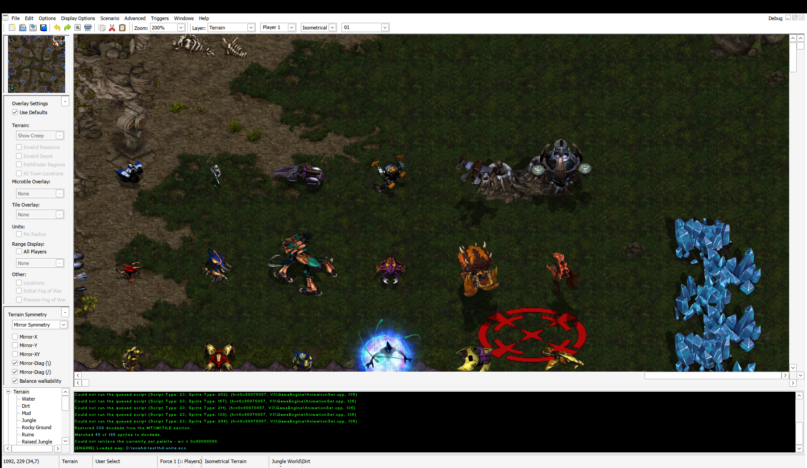
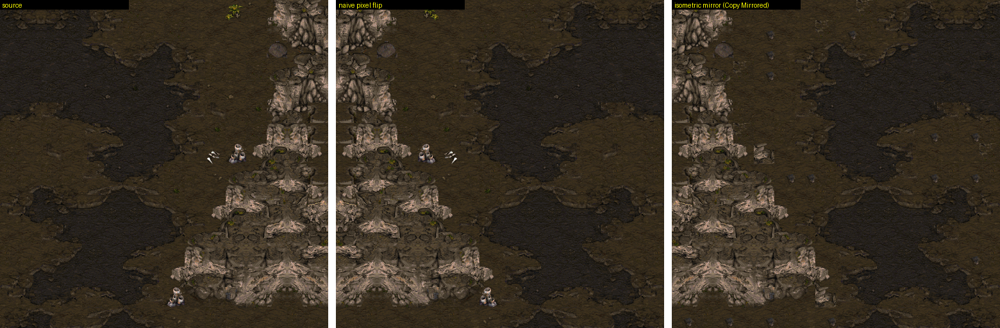
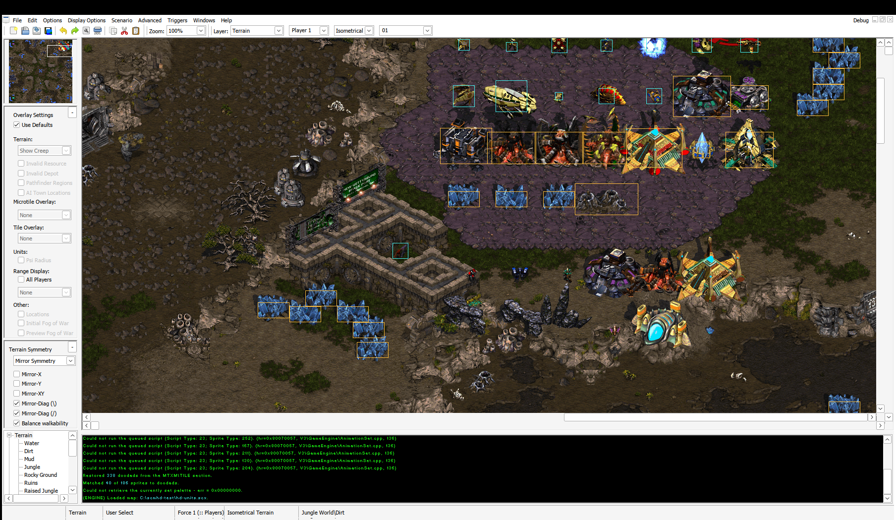
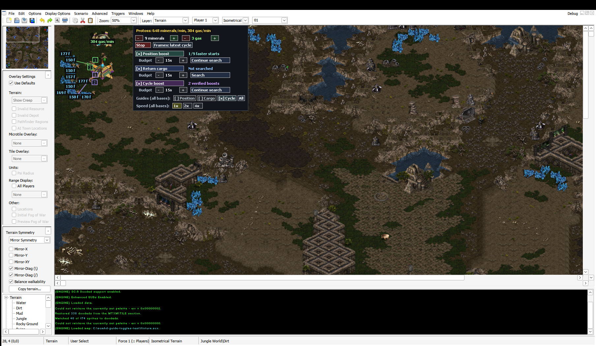

# ScmDraft Fan Add-on

## Installation

**[Download the Windows installer (.exe)](https://github.com/RustyNovoBland77464/scmdraft-fan-addon/releases/download/v0.1.4-preview.2/scmdraft-fan-addon-0.1.4-setup.exe)** · [Portable ZIP](https://github.com/RustyNovoBland77464/scmdraft-fan-addon/releases/download/v0.1.4-preview.2/scmdraft-fan-addon-0.1.4-windows-x86.zip)

1. Install **ScmDraft 2 0.9.10** and confirm it launches. Fan Add-on requires a specific build; Setup checks compatibility.
2. Install **StarCraft: Remastered** locally, including its game data.
3. Close ScmDraft and run **`scmdraft-fan-addon-0.1.4-setup.exe`**. No ZIP extraction is needed.
4. Select your existing ScmDraft executable and confirm installation.
5. Choose the StarCraft game folder containing **`Data`** when prompted.
6. Launch ScmDraft normally. In its own profile settings, also select the StarCraft game-data folder.
7. Select **New → HD Graphics → Remastered**. To try mining, select **New → Test Mining**, start a base, enable a boost technique, and press **Search**.

See [INSTALL.md](INSTALL.md) for the supported editor hash, manual installation, macOS/Wine setup, troubleshooting and removal.
Building from source instead? Follow [BUILDING.md](BUILDING.md).

An unofficial community extension for ScmDraft 2: HD graphics, additional terrain symmetry tools,
and animated mining analysis with searches for position, Return Cargo and cycle boosts.

**Private preview, version 0.1.4.** Publication and redistribution items are tracked in
[RELEASE_READINESS.md](RELEASE_READINESS.md). This draft is not an announcement of author endorsement.

ScmDraft 2 was created by Suicidal Insanity / Stormcoast Fortress. Fan Add-on builds on that editor
through a separate plugin. The original editor remains separately owned and licensed; this source
release contains our extension, not the original ScmDraft source code.

## Features

- **HD graphics:** Remastered and Carbot terrain, units and sprites read from your own game installation.

  

- **Terrain symmetry:** additional symmetry controls, mirrored terrain copying and alternate terrain selection.

  

- **Hitboxes:** separate overlays for actual building and unit collision boxes, off on launch. Toggle with **Ctrl+Shift+1 / 2**.

  

- **Mining tests:** animated Terran, Protoss and Zerg workers, with per-patch cycle times and income statistics.
- **Boost searches:** timed, resumable searches for position, Return Cargo and cycle boosts.
- **Command guides:** translucent worker markers and arrows, with separate visibility controls.
- **Playback:** 1x, 2x and 4x speed, plus independent testing at multiple bases.

  

## Requirements and downloads

You supply ScmDraft 2 and a local StarCraft installation with the required game data.
HD/Carbot modes require the corresponding available assets and rights to use them.
No game-data archives or original ScmDraft executable are included. Documentation screenshots show locally installed game artwork.

The Windows build targets Windows 10/11 (32-bit plugin, also usable on 64-bit Windows).
Only one exact **32-bit ScmDraft 0.9.10** executable is supported; see [INSTALL.md](INSTALL.md).
The Windows plugin is currently exercised under Wine on macOS. Native Windows compatibility
still needs a clean-machine check. A redistributable macOS application wrapper is not included yet.

- Users: extract the entire Windows package and follow [INSTALL.md](INSTALL.md).
- Developers: see [BUILDING.md](BUILDING.md) and [CONTRIBUTING.md](CONTRIBUTING.md).
- Credits and licensing: [CREDITS.md](CREDITS.md), [LICENSE](LICENSE), [THIRD_PARTY_NOTICES.md](THIRD_PARTY_NOTICES.md).

StarCraft and its artwork belong to Blizzard Entertainment. This is an independent fan project,
not an official Blizzard product. Preserve the original authors' notices and licenses.
